# SOC CHESS — Complete System Architecture Specification
### Enterprise Cyber Operations, Big Data Analytics, Dual-Tier ML & LLM SOAR Platform

---

## 1. High-Level Architectural Diagram (Mermaid)

```mermaid
graph TB
    %% STYLING
    classDef uiLayer fill:#1e1e2e,stroke:#89b4fa,stroke-width:2px,color:#cdd6f4;
    classDef apiLayer fill:#181825,stroke:#a6e3a1,stroke-width:2px,color:#cdd6f4;
    classDef aiLayer fill:#11111b,stroke:#f38ba8,stroke-width:2px,color:#cdd6f4;
    classDef soarLayer fill:#181825,stroke:#fab387,stroke-width:2px,color:#cdd6f4;
    classDef dataLayer fill:#1e1e2e,stroke:#cba6f7,stroke-width:2px,color:#cdd6f4;
    classDef extLayer fill:#313244,stroke:#f9e2af,stroke-width:2px,color:#cdd6f4;

    %% -------------------------------------------------------------
    %% LAYER 1: PRESENTATION & CLIENT LAYER
    %% -------------------------------------------------------------
    subgraph UI ["1. Presentation Layer (React 18 + TypeScript + Vite @ Port 5173)"]
        DASH["Executive Dashboard (/)"]
        MON["Monitor & Packet Capture (/monitor)"]
        SIEM_UI["SIEM Log Explorer (/siem)"]
        ALERT_UI["AI Alerts & Security Analyzer (/ai-alerts)"]
        IOC_UI["IOC Threat Intelligence (/ioc-intelligence)"]
        IR_UI["Incident Response & SOAR (/incident-response)"]
        CASE_UI["SOC Case Management (/soc-cases)"]
        AI_ANA["AI Analysis Terminal (/ai-analysis)"]
    end
    class UI,DASH,MON,SIEM_UI,ALERT_UI,IOC_UI,IR_UI,CASE_UI,AI_ANA uiLayer;

    %% -------------------------------------------------------------
    %% LAYER 2: API GATEWAY & BACKEND CONTROLLERS
    %% -------------------------------------------------------------
    subgraph BACKEND ["2. Backend API Services (FastAPI + Async Uvicorn @ Port 8001)"]
        CORS["CORS & Request Middleware"]
        WS_MGR["WebSocket Packet Streamer"]
        ROUTER_ALERTS["ai_alerts.py (12-Format Parser & Download)"]
        ROUTER_SIEM["siem.py (Splunk REST Proxy)"]
        ROUTER_IOC["ioc.py (Indicator Intelligence & Feeds)"]
        ROUTER_INC["incidents.py (SOAR Incident Tracking)"]
        ROUTER_CASES["cases.py (SOC Case Lifecycle)"]
        ROUTER_ML["ml.py & ml_models.py (Registry & Metrics)"]
        EXPORT_SRV["Server-Side Report Generator (StreamingResponse)"]
    end
    class BACKEND,CORS,WS_MGR,ROUTER_ALERTS,ROUTER_SIEM,ROUTER_IOC,ROUTER_INC,ROUTER_CASES,ROUTER_ML,EXPORT_SRV apiLayer;

    %% -------------------------------------------------------------
    %% LAYER 3: INGESTION & EXTERNAL INTEGRATIONS
    %% -------------------------------------------------------------
    subgraph INGEST ["3. Telemetry Ingestion & Native Engines"]
        TSHARK["TShark Subprocess Engine (tshark -D & live capture)"]
        WIRESHARK_GUI["Native Wireshark GUI (socchess:// protocol)"]
        SPLUNK_REST["Splunk Enterprise REST API (Port 8089)"]
        SPLUNK_WEB["Splunk Web UI (Port 8000)"]
        PARSER_12["12 Multi-Format Parsers (Syslog, Snort, Zeek, Suricata, AWS, etc.)"]
        DATASETS["Big Data Storage (3,708 Files: CIC-IDS, UNSW, KDD)"]
    end
    class INGEST,TSHARK,WIRESHARK_GUI,SPLUNK_REST,SPLUNK_WEB,PARSER_12,DATASETS extLayer;

    %% -------------------------------------------------------------
    %% LAYER 4: BIG DATA & CANONICAL FEATURE PIPELINE
    %% -------------------------------------------------------------
    subgraph SPARK_PIPE ["4. Big Data Processing & Feature Engineering"]
        SPARK["Apache Spark 3.5.3 (Structured Streaming & PySpark)"]
        FEATURE_ENG["19 Canonical Feature Extractor (Flow rates, flags, duration)"]
        PREPROC["Preprocessing Pipeline (StandardScaler + Log1p Smoothing)"]
    end
    class SPARK_PIPE,SPARK,FEATURE_ENG,PREPROC dataLayer;

    %% -------------------------------------------------------------
    %% LAYER 5: DUAL-TIER ML & CYBER RISK SCORING
    %% -------------------------------------------------------------
    subgraph AI_ENGINE ["5. Dual-Tier ML & Threat Classification"]
        MLP["Tier 1: 3-Layer MLP Neural Network (128->64->32 ReLU)"]
        ENSEMBLE["Tier 2: High-Capacity Ensemble (Random Forest + XGBoost)"]
        RISK_ENG["Cyber Risk Scoring Algorithm (0-100 Normalized Score)"]
        MITRE_MAP["MITRE ATT&CK Matrix Tagger (T1110, T1059, T1070)"]
    end
    class AI_ENGINE,MLP,ENSEMBLE,RISK_ENG,MITRE_MAP aiLayer;

    %% -------------------------------------------------------------
    %% LAYER 6: 4-TIER LLM GATEWAY & SOAR AUTOMATION
    %% -------------------------------------------------------------
    subgraph LLM_SOAR ["6. LLM Gateway & SOAR Automation"]
        LLM_GW["4-Tier Cascading LLM Gateway"]
        NIM["Tier 1: NVIDIA NIM (Llama-3.2-11b-Vision)"]
        OPENAI["Tier 2: OpenAI (GPT-4o)"]
        GEMINI["Tier 3: Google Gemini API"]
        RULE_LLM["Tier 4: Rule-Based Fallback Synthesis"]
        PLAYBOOK["SOAR Playbook Engine (iptables, PowerShell, checklists)"]
        IOC_EXTRACT["IOC Regex Engine (8 Categories: IPs, C2, Hashes, Files)"]
    end
    class LLM_SOAR,LLM_GW,NIM,OPENAI,GEMINI,RULE_LLM,PLAYBOOK,IOC_EXTRACT soarLayer;

    %% -------------------------------------------------------------
    %% LAYER 7: PERSISTENCE & EXPORT STORAGE
    %% -------------------------------------------------------------
    subgraph STORAGE ["7. Persistence & Data Stores"]
        MYSQL[("MySQL Database (WAMP64 @ Port 3306)")]
        MODEL_STORE[("Model Registry (.pkl, .joblib, .json)")]
        EXPORT_FILES[("Server-Side Reports (PDF/HTML, DOC, TXT, CSV, JSON)")]
    end
    class STORAGE,MYSQL,MODEL_STORE,EXPORT_FILES dataLayer;

    %% -------------------------------------------------------------
    %% DATA FLOW INTERCONNECTS
    %% -------------------------------------------------------------
    UI -->|REST API Requests & Polling| CORS
    MON <-->|Sub-Second WebSocket Telemetry| WS_MGR
    WS_MGR <-->|Controlled Subprocess Stream| TSHARK
    MON -.->|socchess:// URI Trigger| WIRESHARK_GUI
    SIEM_UI -.->|Direct Browser Launch| SPLUNK_WEB

    CORS --> ROUTER_ALERTS & ROUTER_SIEM & ROUTER_IOC & ROUTER_INC & ROUTER_CASES & ROUTER_ML
    ROUTER_SIEM <-->|TLS REST Search & Token Auth| SPLUNK_REST

    ROUTER_ALERTS --> PARSER_12
    PARSER_12 --> FEATURE_ENG
    DATASETS --> SPARK --> FEATURE_ENG
    FEATURE_ENG --> PREPROC

    PREPROC --> MLP
    PREPROC --> ENSEMBLE
    MLP & ENSEMBLE --> RISK_ENG --> MITRE_MAP

    ROUTER_ALERTS --> IOC_EXTRACT
    MITRE_MAP & IOC_EXTRACT --> LLM_GW
    LLM_GW --> NIM
    NIM -.->|Failover| OPENAI -.->|Failover| GEMINI -.->|Failover| RULE_LLM

    LLM_GW & MITRE_MAP --> PLAYBOOK
    PLAYBOOK --> ROUTER_INC

    ROUTER_CASES & ROUTER_INC & ROUTER_ALERTS <-->|SQL Queries & Mutations| MYSQL
    ROUTER_ML <-->|Load & Inspect Model Artifacts| MODEL_STORE
    ROUTER_ALERTS --> EXPORT_SRV --> EXPORT_FILES
    EXPORT_FILES -->|HTTP Attachment Download| UI
```



---

## 2. Text / ASCII System Architecture Diagram

```
=======================================================================================================
                                 SOC CHESS PLATFORM ARCHITECTURE
=======================================================================================================

+-----------------------------------------------------------------------------------------------------+
|                                1. PRESENTATION LAYER (React 18 + TS)                                |
|   http://localhost:5173  |  Dark Theme Glassmorphism  |  Vite Bundler  |  Tailwind CSS               |
|                                                                                                     |
|  [Dashboard]      [Monitor]       [SIEM]        [AI Alerts]     [IOC Intel]    [SOAR IR]    [Cases] |
|   (/)             (/monitor)      (/siem)       (/ai-alerts)    (/ioc-intel)   (/incident)  (/cases)|
+--------+--------------+--------------+---------------+---------------+-------------+-----------+----+
         |              |              |               |               |             |           |
         | (HTTP REST)  | (WebSockets) | (SPL Link)    | (Report DL)   | (IOC Query) | (Playbook)|   |
         v              v              v               v               v             v           v   |
+------------------------------------------------------------------------------------------------+    |
|                        2. FASTAPI BACKEND GATEWAY (Python 3.10+ @ Port 8001)                   |    |
|   - CORS Middleware  - Async Uvicorn Worker  - Pydantic Validation  - Error Interceptors       |    |
|                                                                                                |    |
|  +--------------------+  +----------------------+  +---------------------+  +---------------+  |    |
|  | ai_alerts.py       |  | siem.py              |  | ioc.py & inc.py     |  | cases.py      |  |    |
|  | 12-Format Parsers  |  | Splunk REST Proxy    |  | Threat Feeds & SOAR |  | Case CRUD     |  |    |
|  +--------------------+  +----------------------+  +---------------------+  +---------------+  |    |
+-----------+--------------------------+-----------------------+----------------------+----------+----+
            |                          |                       |                      |          |
            | (Raw Telemetry)          | (REST API :8089)      | (IOC / Intel)        | (State)  |
            v                          v                       v                      v          |
+-----------------------+  +----------------------+  +--------------------+  +----------------+  |
| 3. INGESTION ENGINES  |  | SPLUNK ENTERPRISE    |  | IOC REGEX ENGINE   |  | WAMP64 MYSQL   |  |
| - Wireshark / TShark  |  | - Port 8089 (REST)   |  | - 8 Artifact Types |  | - Port 3306    |  |
| - 12 Log Parsers      |  | - Port 8000 (Web UI) |  | - IPs, URLs, C2    |  | - soc_cases    |  |
| - 3,708 Dataset Files |  | - CIM Data Models    |  | - Hashes, Files    |  | - alerts_db    |  |
+-----------+-----------+  +----------------------+  +---------+----------+  +----------------+  |
            |                                                  |                                 |
            v                                                  |                                 |
+---------------------------------------------------+          |                                 |
| 4. BIG DATA & CANONICAL FEATURE PIPELINE          |          |                                 |
| - Apache Spark 3.5.3 (PySpark Structured Stream)  |          |                                 |
| - 19 Canonical Flow & Security Event Features     |          |                                 |
| - StandardScaler Normalization + Log1p Smoothing  |          |                                 |
+---------------------------+-----------------------+          |                                 |
                            |                                  |                                 |
                            v                                  |                                 |
+---------------------------------------------------+          |                                 |
| 5. DUAL-TIER MACHINE LEARNING DETECTION ENGINE    |          |                                 |
|                                                   |          |                                 |
|  [TIER 1: REAL-TIME MLP NEURAL NETWORK]           |          |                                 |
|  - 3 Hidden Layers: 128 -> 64 -> 32 (ReLU)        |          |                                 |
|  - Output: Softmax Multi-Class Threat Category    |          |                                 |
|  - Latency: < 1.2ms per event                     |          |                                 |
|                                                   |          |                                 |
|  [TIER 2: BATCH ENSEMBLE CLASSIFIER]              |          |                                 |
|  - Random Forest (200 Trees) + XGBoost Ensemble   |          |                                 |
|                                                   |          |                                 |
|  [RISK & MITRE ENGINE]                            |          |                                 |
|  - Normalized Threat Score: 0 to 100.0            |          |                                 |
|  - MITRE ATT&CK Mapping: T1110, T1059, T1070      |          |                                 |
+---------------------------+-----------------------+          |                                 |
                            |                                  |                                 |
                            v                                  v                                 |
+---------------------------------------------------------------------------------------------+  |
| 6. HYBRID 4-TIER LLM GATEWAY & SOAR PLAYBOOK AUTOMATION                                     |  |
|                                                                                             |  |
|  [CASCADING LLM FAILOVER GATEWAY]                                                           |  |
|  Primary: NVIDIA NIM (meta/llama-3.2-11b-vision-instruct)                                   |  |
|    |--> Failover: OpenAI (gpt-4o / gpt-3.5-turbo)                                           |  |
|           |--> Failover: Google Gemini API                                                  |  |
|                  |--> Fallback: Local Deterministic Rule Engine                             |  |
|                                                                                             |  |
|  [SOAR PLAYBOOK ENGINE]                                                                     |  |
|  - Dynamic Firewall Containment Script: iptables DROP, Windows netsh, net user disable      |  |
|  - Automated 5-Stage SOC Investigation & Remediation Playbook                               |  |
+---------------------------------------------------------------------------------------------+  |
                                             |                                                   |
                                             v                                                   v
+------------------------------------------------------------------------------------------------+
| 7. SERVER-SIDE EXPORT & REPORT GENERATION ENGINE                                               |
|    POST /api/ai-alerts/download-report -> StreamingResponse (Content-Disposition: attachment)  |
|    Formats:  [PDF / Print HTML]   [DOC Word]   [TXT Raw]   [CSV Log]   [JSON Struct]           |
+------------------------------------------------------------------------------------------------+
```

---

## 3. Layer-by-Layer Detailed Technical Breakdown

### Layer 1: Presentation & SOC Command Console
* **Technology**: React 18, TypeScript, Vite, Tailwind CSS, Lucide Icons, Recharts.
* **Hosting**: Development server on `http://localhost:5173`.
* **Sub-Modules**:
  1. **Executive Dashboard (`/`)**: Enterprise risk overview, threat distribution pie charts, live alert cards.
  2. **Live Monitor (`/monitor`)**: WebSocket client receiving live packet flows directly from TShark; protocol metrics (TCP, UDP, DNS, TLS).
  3. **SIEM Explorer (`/siem`)**: Interactive Splunk query runner, Windows Security event log aggregator (4625, 4688, 1102).
  4. **AI Alerts & Security Analyzer (`/ai-alerts`)**: Telemetry editor with 12 pre-loaded threat formats, live MLP scan trigger, IOC matrix, and server-side report download toolbar.
  5. **IOC Intelligence (`/ioc-intelligence`)**: Search terminal for IPs, domains, hashes, CVEs, cross-referenced with threat intelligence feeds and NVIDIA NIM.
  6. **Incident Response (`/incident-response`)**: Active security incident tracking board with containment triggers and MITRE playbook checklists.
  7. **SOC Cases (`/soc-cases`)**: Full case management (New, Under Investigation, Contained, Closed) backed by MySQL.
  8. **AI Analysis Terminal (`/ai-analysis`)**: Conversational cybersecurity AI assistant powered by the LLM Gateway.

---

### Layer 2: Backend API & Service Controllers
* **Technology**: Python 3.10+, FastAPI, Starlette, Uvicorn (ASGI), Pydantic v2.
* **Hosting**: `http://localhost:8001` (Async, non-blocking I/O).
* **Core Responsibilities**:
  * **CORS & Middleware**: Configured for local cross-origin requests from `http://localhost:5173`.
  * **Router Architecture**: Modular routers for `ai_alerts`, `siem`, `ioc`, `incidents`, `cases`, `ml`, `auth`.
  * **Streaming Engine**: FastAPI `StreamingResponse` with `Content-Disposition: attachment` headers for file exports (bypassing browser blob sandbox restrictions).
  * **Process Control**: Safe Windows subprocess management for TShark packet capture without command injection vulnerabilities.

---

### Layer 3: Telemetry Ingestion & Data Sources
* **Live Network Capture**:
  * **TShark CLI**: Interrogates host network interfaces (`tshark -D`) and pipes live dissected frame metadata into WebSocket buffers.
  * **Wireshark GUI Link**: Registered custom URL protocol scheme (`socchess://wireshark`) enabling one-click launch of desktop Wireshark with pre-filtered display.
* **Enterprise SIEM Logs**:
  * **Splunk Enterprise REST API**: Authenticates via token/credentials to `https://localhost:8089/services/search/jobs` for live SPL execution.
  * **Splunk Web**: Direct launch to `http://localhost:8000`.
* **Multi-Format Raw Parser**:
  * Ingests and normalizes **12 industry standard log formats**:
    1. Splunk CIM (Common Information Model)
    2. Snort IDS Alerts
    3. Zeek (Bro) Connection Logs (`conn.log`, `dns.log`)
    4. Suricata EVE JSON
    5. Linux /var/log/syslog & auth.log
    6. AWS CloudTrail Audit JSON
    7. Nmap Network Port Scanner XML
    8. Palo Alto Networks Traffic Logs
    9. Windows Security EVTX (XML/JSON text)
    10. Cisco ASA Firewall Logs
    11. Bro HTTP Transaction Logs
    12. Raw Network Flow CSV / PCAP text

---

### Layer 4: Big Data & Feature Engineering Pipeline
* **Engine**: Apache Spark 3.5.3 (PySpark structured streaming + batch processing).
* **Storage Footprint**: 3,708 dataset files across CIC-IDS-2017, CSE-CIC-IDS2018, UNSW-NB15, and KDD-99.
* **19 Canonical Features**:
  * Flow metrics: `duration`, `src_port`, `dst_port`, `protocol_type`, `total_fwd_packets`, `total_bwd_packets`, `flow_bytes_s`, `flow_packets_s`.
  * Packet length statistics: `packet_length_mean`, `packet_length_std`, `packet_length_max`.
  * Security flags: `syn_flag_count`, `rst_flag_count`, `ack_flag_count`, `fin_flag_count`.
  * Host log flags: `is_admin_action`, `event_code_weight`, `failed_logon_ratio`, `process_depth`.
* **Mathematical Transformations**:
  * Outlier suppression: $x' = \ln(1 + |x|)$ (Symmetrical Log1p smoothing).
  * Scaling: Z-score standardization via `StandardScaler(mean=0, std=1)`.

---

### Layer 5: Dual-Tier Machine Learning & Cyber Risk Scoring
* **Tier 1: Real-Time Multi-Layer Perceptron (MLP) Neural Network**:
  * **Architecture**: Input layer (19 features) $\rightarrow$ Dense 128 (ReLU) $\rightarrow$ Dense 64 (ReLU) $\rightarrow$ Dense 32 (ReLU) $\rightarrow$ Softmax (9 Attack Classes).
  * **Inference Speed**: $< 1.2\text{ ms}$ per telemetry line.
  * **Classes**: Normal Traffic, Brute Force / Credential Spraying, Infiltration, Port Scan / Reconnaissance, Denial of Service (DoS), Distributed DoS (DDoS), Web Exploits, Botnet C2, Privilege Escalation.
* **Tier 2: High-Capacity Batch Ensemble**:
  * **Models**: Scikit-Learn `RandomForestClassifier` (200 estimators) + XGBoost.
  * **Accuracy**: 99.39% test accuracy across mixed benchmark corpora.
* **Cyber Risk Scoring Engine**:
  * Dynamic formula combining MLP class probability, failed event counts, and privileged target asset value:
    $$\text{Risk Score} = \min\left(100.0,\, P(\text{Attack}) \times 80 + \sum w_i \cdot \text{Severity}_i + \text{TargetAssetWeight}\right)$$
  * Thresholds: `LOW` (0–39), `MEDIUM` (40–69), `HIGH` (70–89), `CRITICAL` (90–100).
* **MITRE ATT&CK Matrix Mapping**:
  * Automated mapping of attack predictions to MITRE techniques:
    * Brute Force $\rightarrow$ `T1110.003` (Password Spraying)
    * Infiltration $\rightarrow$ `T1059.001` (PowerShell Execution)
    * Log Deletion $\rightarrow$ `T1070.001` (Clear Event Logs)
    * Port Scanning $\rightarrow$ `T1046` (Network Service Discovery)

---

### Layer 6: Hybrid LLM Threat Intelligence & SOAR Automation
* **4-Tier LLM Gateway**:
  * **Tier 1**: NVIDIA NIM API (`meta/llama-3.2-11b-vision-instruct`) with pooled keep-alive session and 55s timeout handling.
  * **Tier 2**: OpenAI API (`gpt-4o` / `gpt-3.5-turbo`) fallback.
  * **Tier 3**: Google Gemini API fallback.
  * **Tier 4**: Local deterministic rule-based template engine (guarantees 100% operational uptime if network is isolated).
* **SOAR Playbook Generator**:
  * **Dynamic Containment Script Synthesis**: Generates copy-pasteable firewall containment commands tailored to the operating system and detected threat IP:
    * Linux: `sudo iptables -A INPUT -s <Attacker_IP> -j DROP`
    * Windows: `netsh advfirewall firewall add rule name="SOC_BLOCK" dir=in action=block remoteip=<Attacker_IP>`
    * Active Directory: `net user <Compromised_User> /active:no`
  * **Automated SOC Checklist**: 5-step forensic action sequence (Host Isolation, Firewall Enforcement, Sensitive Port Inspection, NetFlow Correlation, Forensic Case Preservation).
* **IOC Extraction Engine**:
  * High-performance regex extraction across 8 categories:
    1. Suspicious Attacker IPs
    2. Target Asset IPs
    3. C2 URLs & Web Endpoints
    4. Analyst / Operator Emails
    5. Domains & Fully Qualified Hostnames
    6. File Hashes (SHA256, MD5, SHA1)
    7. Malicious Process & Script Files (`cmd.exe`, `stager.ps1`)
    8. Common Vulnerabilities and Exposures (CVE identifiers)

---

### Layer 7: Persistence & Multi-Format Report Generation
* **Database (MySQL on WAMP64)**:
  * Port: `3306`
  * Tables: `soc_cases`, `ai_alerts`, `threat_incidents`, `model_registry`, `audit_logs`.
* **Server-Side Multi-Format Download System**:
  * **Endpoint**: `POST /api/ai-alerts/download-report`
  * Generates genuine files on the backend and streams with HTTP `Content-Disposition`:
    * **PDF Report**: Standalone CSS-styled HTML print template (opens in browser $\rightarrow$ `Ctrl+P` $\rightarrow$ Save as PDF).
    * **DOC Report**: Standard Microsoft Word binary MIME stream (`application/msword`).
    * **TXT Report**: Raw plain-text forensic transcript (`text/plain`).
    * **CSV Report**: Tabular structured metrics (`text/csv`).
    * **JSON Report**: Machine-readable full incident payload (`application/json`).

---

## 4. Network Port & Service Mapping Table

| Port | Protocol | Component | Role |
|---|---|---|---|
| **5173** | HTTP / TCP | React + Vite UI | Frontend SOC Command Console |
| **8001** | HTTP / TCP | FastAPI / Uvicorn | REST API & WebSocket Telemetry Server |
| **8000** | HTTP / TCP | Splunk Enterprise Web | Web Search & Dashboards |
| **8089** | HTTPS / TLS | Splunk Management REST API | Programmatic SPL Search Ingestion |
| **3306** | MySQL / TCP | WAMP64 MariaDB / MySQL | Relational Storage for Incidents & Cases |
| **443** | HTTPS / TLS | NVIDIA NIM / OpenAI Cloud | Outbound LLM Gateway API Calls |
